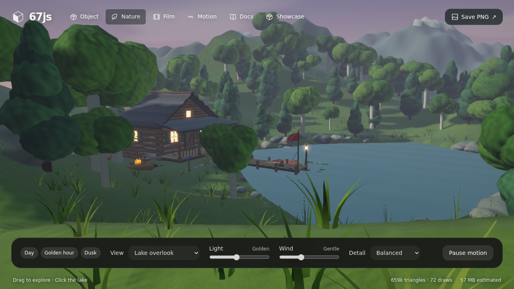
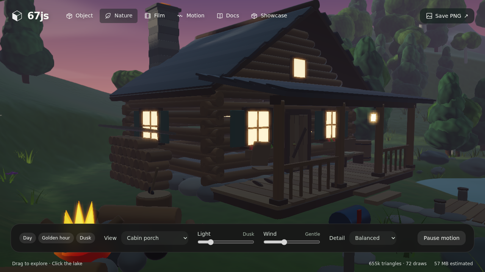

# Mirror Lake Cabin

An interactive 3D scene of a log cabin on an alpine lake at golden hour, built entirely from code with the [67.js](https://github.com/codepawl/67.js) WebGL engine. No 3D models, no textures, no downloads: every log, rock, tree and ripple is generated geometry.

**Live demo:** https://abhi478jeetur-rgb.github.io/mirror-lake-cabin/



## What's in the scene

- A mirror-still lake with click-to-ripple water
- Log cabin with a porch, glowing windows, chimney and a woodpile
- Campfire with animated flames
- Wooden dock with a flag, a lantern and a rowboat
- Water lilies, pine forest and snowy mountains
- Six camera viewpoints, a light slider (day, golden hour, dusk) and a wind slider



## Controls

| Action | How |
| --- | --- |
| Orbit | Drag, or use the arrow keys |
| Zoom | Scroll, or press + / - |
| Ripple | Click the lake |
| Viewpoint | "View" menu (6 angles) |
| Time of day | "Light" slider or the Day / Golden hour / Dusk buttons |
| Screenshot | "Save PNG" |

## Run it locally

`index.html` is the whole scene in one file (engine, scene and UI). Download it and open it in Chrome, Edge or Firefox. It needs WebGL2 and works offline.

## Project structure

```
index.html                 the complete, self-contained scene
src/cabin-world.js         landscape, lake, terrain, lighting and cameras
src/cabin-props.js         cabin, dock, boat, campfire and other props
src/cabin-viewer.js        controls, UI and render loop
src/cabin.html             page template used for the build
src/vite.cabin.config.mjs  single-file build config
screenshots/               preview images
```

## Rebuild from source

1. Clone the engine: `git clone https://github.com/codepawl/67.js`
2. Copy `src/*.js` into its `src/` folder, and `src/cabin.html` plus `src/vite.cabin.config.mjs` into its root.
3. Run:

```
npm ci
npm i -D vite-plugin-singlefile
npx vite build --config vite.cabin.config.mjs
```

The output is `dist-cabin/cabin.html`. Rename it to `index.html`.

## Credits

- Engine: [67.js](https://github.com/codepawl/67.js) by CodePawl, MIT License (see `LICENSE-67js`).
- Scene design and code: Abhijeet Kumar.
